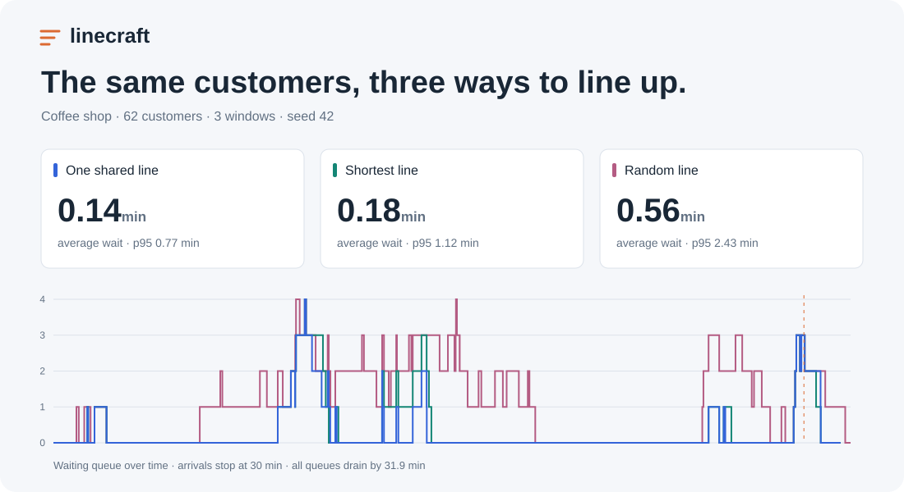

# Linecraft

A queue simulator comparing one shared line, separate shortest lines and randomly chosen lines.
Each setup gets the same arrivals and service times, so you can compare the waits directly.

[Try it](https://echuq.github.io/linecraft/) · [Tests](https://github.com/echuq/linecraft/actions/workflows/test.yml)



Change the number of windows, arrival rate or service times, then replay the run.
The seed makes a run repeatable; the link saves its settings. CSV export includes
each customer's arrival, service time, window, start, finish and wait.

## Run locally

Node.js 22 or later. No dependencies to install.

```sh
git clone https://github.com/echuq/linecraft.git
cd linecraft
node scripts/serve.mjs
```

Open http://127.0.0.1:4173. For an offline HTML file, run
`node scripts/standalone.mjs` and open `dist/linecraft.html`.
The files in `public/` also work on a static host; they need a server for module imports.

## The model

| Setup | Routing |
| --- | --- |
| Shared | First come, first served; use the first available window |
| Shortest | Count everyone in each line, including the person being served; break ties randomly |
| Random | Choose a window uniformly on arrival |

There is no switching between lines. The shortest-line rule cannot see future
service times. With one window, all three setups give the same result.

Arrivals follow a constant-rate Poisson process. Service times are fixed,
Erlang (shape 4), or exponential, with the same configured mean. The customer
stream is generated once per run and reused across all three setups.
Changing parameters can change that stream, even with the same seed.

After arrivals stop, the queues drain completely. Wait statistics include those
served after closing. The chart counts people waiting, not people in service;
the summary shows the mean, interpolated 95th percentile and largest total queue.

Expected load is `arrivalRate * serviceMean / servers`, not measured utilization.
At 100% or above, a finite run says nothing about stable long-run waits.
Breaks, abandonment, priorities and walking time are not modelled. These are
simulations, not measured queues, and one seed is not a confidence interval.
Last-digit results may vary between JavaScript engines.

## Development

```sh
node --test
node --check public/app.js
node scripts/example.mjs
```

The last command regenerates the figure above and its JSON data from the engine.
Tests include a hand-calculated case, FIFO and capacity checks across 30 seeds,
replay/CSV output, and the queue-area and finite-run Little identities.

The simulation is in `public/engine.js`; the UI is in `public/app.js`.
The local server binds to loopback and serves only allowlisted files.

MIT license.
